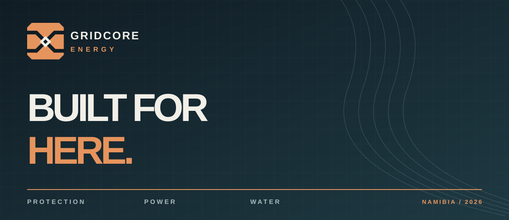
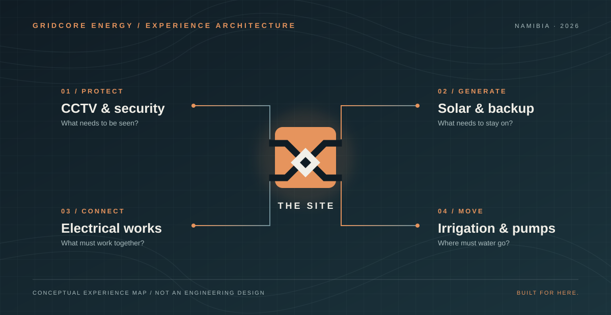
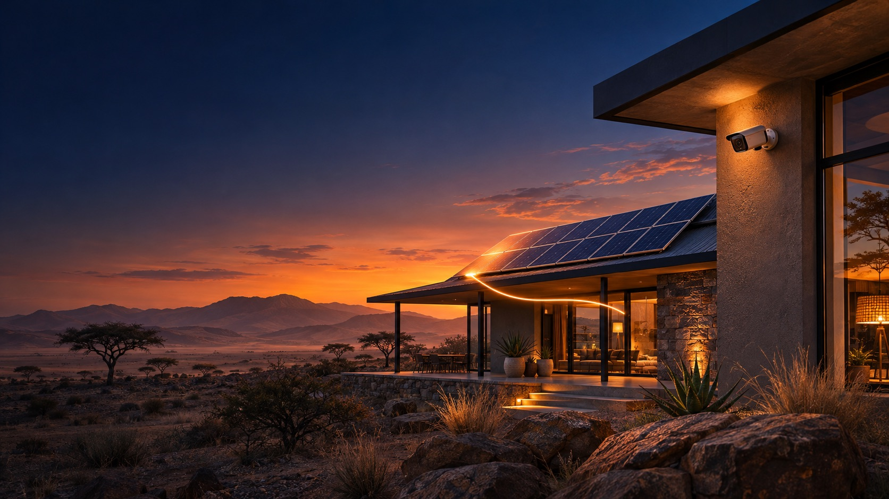

<h1 align="center">GridCore Energy — Built for Here</h1>

  <strong>A site-first digital experience for protection, power and water in Namibia.</strong> 
  Identity, experience design and development by SolarSpin Technologies.

  <a href="https://gridcore.pages.dev/"><strong>Explore GridCore ↗</strong></a>
  &nbsp;·&nbsp;
  <a href="https://solarspin-namibia.xyz/">SolarSpin Technologies</a>

<strong>Live build — November 2026</strong>

## The brief

GridCore Energy works across four connected installation disciplines: **CCTV and security, solar and backup power, electrical work, and irrigation and pumping**. The website needed to make each service understandable on its own while giving CCTV a focused path from campaign visit to qualified quotation enquiry.

The audience ranges from homeowners and businesses to property managers and farms. Each arrives with a place, a problem and a different level of technical detail. The experience asks for the useful context first, then creates a clear route to follow-up.

## One site, four systems

A property is not a stack of unrelated products. Its entrance, electrical supply, backup needs and water route belong to the same physical place. **Built for Here** turns that idea into the brand and the navigation.

- **Protect** — understand entrances, edges and essential spaces.
- **Generate** — consider the loads that need solar and backup power.
- **Connect** — relate electrical work to the systems it supports.
- **Move** — follow water from source through pump to use.

The visitor can start with any discipline. Every path returns to one practical question: **Where does this system need to work?**

## An identity shaped by the site

The **Convergence Tile** is a compact copper mark with four dark routes meeting at a pale central core. Its clipped outline makes a recognisable browser icon, while a custom two-line GRID / CORE lockup keeps the name legible in a narrow phone header.

Basalt gives the interface depth; copper carries the action and the warmth of Namibian light; salt creates quiet reading surfaces; restrained oxidised cyan marks technical signals. Tight display typography, tracked micro labels, topographic lines and tactile image crops make the site feel engineered without making it cold.

[Explore the GridCore identity board ↗](assets/identity-board.png)

*Campaign photography in this case study is conceptual artwork, not documentation of completed GridCore installations.*

## The visitor experience

| Journey | What it does |
| --- | --- |
| **Home** | Opens with the core promise, then lets visitors move through a service atlas, connected-system story and clear quotation routes. |
| **CCTV** | Leads with “See the whole picture” and an interactive coverage explorer for home, business and farm scenarios. The visual zones help frame questions for a site assessment. |
| **Solar, electrical and irrigation** | Give each discipline its own editorial story and simple system diagram, with a direct route to a relevant enquiry. |
| **About** | Explains the four disciplines through a single site-first point of view. |
| **Contact** | Collects the location and project details needed for a useful reply, alongside call and WhatsApp routes. |

The CCTV coverage shapes are illustrative. Actual placement, equipment and privacy decisions belong to a site assessment.

## Location and enquiry, connected

The contact journey asks for service, property type, town or area, project description and preferred reply channel. A successful submission is recorded server-side before the visitor sees confirmation. Campaign source details travel with the enquiry, while button interactions are counted separately from completed requests.

A live OpenStreetMap view gives geographic context. GeoNames town centres focus selected town views, and a Google Maps URL opens the visitor's entered location. This lets the map support a project conversation without implying a fixed GridCore office pin or an unverified service radius. A visitor can also choose to continue the recorded brief on WhatsApp.

## Built for the real browser

The site uses a Cloudflare Pages advanced-mode Worker with D1 for private enquiry records. Its public pages are composed for phone, tablet and desktop. Original imagery, a short branded opening, animated signal lines, topographic fields and tactile transitions give the experience movement; semantic controls, visible keyboard focus, descriptive alternatives and reduced-motion handling keep the content usable when motion is absent.

This repository is a public record of the design and visitor experience. The production source, Cloudflare configuration, enquiry data and credentials stay private. [Read the publication boundary](PUBLICATION_BOUNDARY.md).

## Credits

**Project:** GridCore Energy, Namibia  
**Identity, creative direction, experience design and development:** [SolarSpin Technologies](https://solarspin-namibia.xyz/)  
**Live website:** [gridcore.pages.dev](https://gridcore.pages.dev/)

© 2026 GridCore Energy and SolarSpin Technologies. Public visibility of this case study does not grant permission to reuse its identity, artwork or writing as a commercial template.
